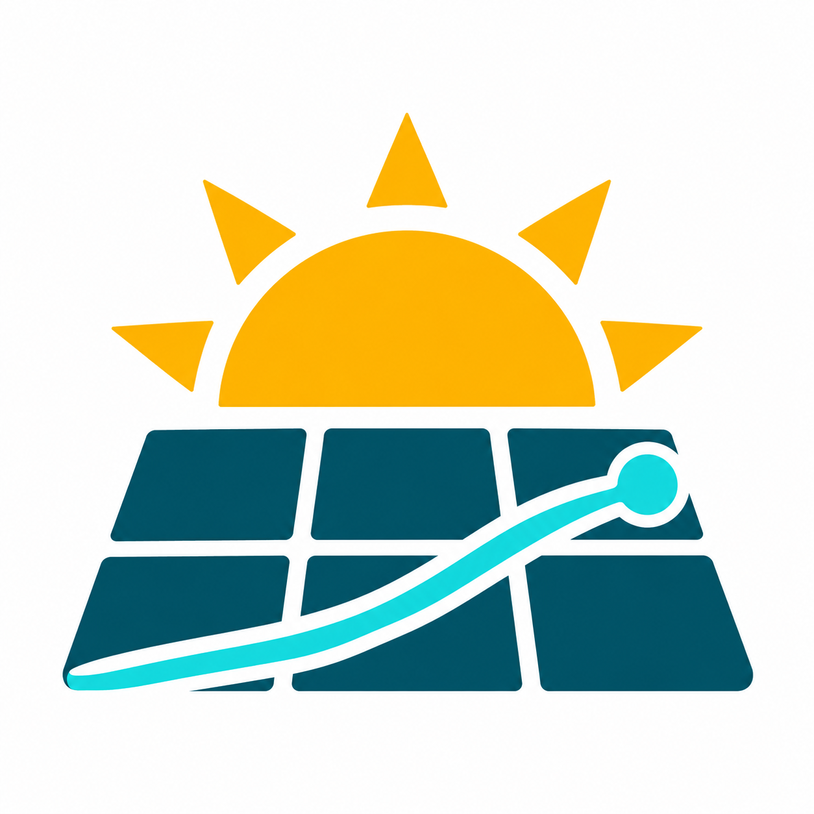

# Adaptive Solar für Home Assistant

<p align="center">
  
</p>

[Dokumentation](docs/README.md) · [Versionshinweise](docs/releases/README.md) · [Fehler melden](https://github.com/togo42/Adaptive-Solar/issues)

Adaptive Solar verbindet Open-Meteo-Wetterprognosen, PV-Physik und lokale
Residualmodelle. Die Integration prognostiziert das **verfügbare PV-Potenzial
ohne betriebliche Abregelung**: Leistung, Resttag und bis zu sechs Folgetage,
abhängig von der eingestellten und tatsächlich verfügbaren Wetterabdeckung.

Unterschiedliche Stringausrichtungen, gemeinsame AC-/DC-Ausgangsstufen und
wiederkehrende Verschattung werden berücksichtigt. Frische HA-Messungen für
Temperatur, Wind, horizontale Globalstrahlung und PV-Leistung unterstützen
kurzfristige Korrekturen. Ohne qualifizierte Lernhistorie bleibt die Physik aktiv.
Ein gemeinsamer Zähler kann keine Einzelstringverluste identifizieren.

**Dokumentierter Release: 0.2.18, Stand 29.10.2026.** Neu sind gespeicherte
[Stundenkurven der Tagesbeginnprognose](docs/technik/day-start-curve.md).
[Änderungen und Upgrade](docs/releases/release-0.2.18.md),
[historische Quell- und Testnachweise](docs/entwicklung/pruefnachweise.md).
Tests und Reviews belegen keinen Genauigkeitsvorsprung gegenüber anderen
Integrationen; dafür bleibt ein [prospektiver Vergleich](docs/entwicklung/validierung.md) erforderlich.

## Installation und Bedienung

1. [Plattform und Abhängigkeiten prüfen](docs/anwendung/installation.md).
   HACS-Mindestversion ist Core **2026.10.2**; die vollständige Suite für 0.2.18
   wurde unter **2026.10.4 / Python 3.14** geprüft. Frühere Nachweise für .2/.3
   sind historisch. Für HAOS ist bislang nur **amd64 / CPython 3.14 / Musl**
   mit separat bereitgestellter Binärbasis qualifiziert;
   [HAOS-Bau- und Installationsweg](docs/anwendung/haos-installation.md).
2. In HACS unter **Benutzerdefinierte Repositories**
   `https://github.com/togo42/Adaptive-Solar` als **Integration** hinzufügen,
   eine veröffentlichte Version herunterladen und Home Assistant neu starten.
3. Unter **Einstellungen → Geräte & Dienste → Integration hinzufügen → Adaptive Solar**
   Standort, Ausgangsstufen und Strings einrichten. Bestehende Einträge beim Upgrade
   weiterverwenden. [Bedienung und Fehlerbehebung](docs/anwendung/bedienung.md).

Die [Installationsanleitung](docs/anwendung/installation.md) enthält auch manuelle
Installation, Sicherung, Erfolgskontrolle und Rückweg. Ein HACS-Download ersetzt
keine fehlende HAOS-Binärabhängigkeit.

Je String werden kWp, Neigung, Azimut und Verluste angegeben:
**0° Nord / 90° Ost / 180° Süd / 270° West**. AC-Stufen haben Wirkungsgrad und
AC-Grenze; DC-Stufen eine nominelle Ausgangsgrenze und optionale Zusatzverluste.
Fiktive [AC-](examples/site.json) und [DC-Beispiele](examples/site-dc.json)
zeigen die herstellerunabhängige Konfiguration. Optionale Horizontprofile und
Morgen-/Abenddämpfung sind Konfigurationsannahmen, keine vermessene Teilverschattung.

Lernen benötigt kumulative PV-Energie am richtigen Messpunkt, der Leistungsnowcast
Leistung in W. Messlücken bleiben fehlend; aktive oder unbekannte konfigurierte
Abregelung sperrt betroffene Lern-/Leistungsbeobachtungen. Die
[Messkontinuitätsregeln](docs/technik/measurement-learning.md) und die
[Ablehnungsdiagnose](docs/technik/ablehnungsdiagnose.md) erklären verwendbare Labels.
Ausgabequalität ist keine Genauigkeitsklasse. Datenflüsse und lokale Aufbewahrung
stehen unter [Datenschutz](docs/anwendung/datenschutz.md).

## Entwicklung

Für native HA-Tests Python 3.14 verwenden; der HA-unabhängige Modellkern unterstützt
Python ab 3.13. Der [Entwicklungsleitfaden](docs/entwicklung/entwicklung.md) beschreibt
die reproduzierbare Installation mit automatischer Übernahme der Manifestpins.

```bash
python3.14 -m venv .venv
.venv/bin/python -m pip install '.[test,ha-test]' 'pvlib==0.16.1' 'scikit-learn==1.9.1'
.venv/bin/python -m pip check
.venv/bin/python -m pytest -q --cov=custom_components.adaptive_solar --cov-branch \
    --cov-report=term-missing:skip-covered --cov-report=xml:artifacts/coverage.xml
.venv/bin/ruff check custom_components tests scripts
```

Synthetische Offline-Demo:

```bash
.venv/bin/python scripts/forecast.py --config examples/site.json --synthetic \
    --as-of 2026-06-21T08:00:00+02:00 --output artifacts/demo.json
```

`--live` ruft Open-Meteo auf und ist nicht rückdatierbar.
Der Entwicklungsstand enthält außerdem einen separaten
[Offline-Kandidaten zur Prüfung der Trainingsabdeckung](docs/technik/learning-support-guard.md)
des Residual-Lerners. Er verändert keine produktiven HA-Prognosen.
[Datenverträge](docs/technik/implementation-contract.md),
[Vergleichsaufnahme](docs/entwicklung/benchmark-aufnahme.md) und
[Reviewablauf](docs/entwicklung/validierung.md#4-lokale-prüfung-und-review)
ergänzen die Entwicklung. Private Zuordnungen und Betriebsprotokolle gehören unter
ignoriertes `data/`, generierte Artefakte unter `artifacts/`, rohe Reviewdaten unter
`reviews/private/`.

## Optionaler Archivbetrieb

Der [Originaldatenexport und Replay](docs/archiv/archivbetrieb.md) archiviert
ursprüngliche Wetter-, Beobachtungs- und Prognosedaten auf einem separaten Host.
Export und Collector werden bewusst eingerichtet; die Prognose benötigt keinen
Archivhost. Die [Hostinstallation](docs/archiv/archiv-host-installation.md)
verwendet eine [eigene Laufzeit ohne HA Core](docs/archiv/archiv-runtime-ohne-ha.md).
HACS aktualisiert weder externe Hostdienste noch Dashboardressourcen.

Originaldateien und ein wiederaufbaubarer SQLite-Index sind die Speicherbasis.
24 Monate Retention sind eine Einstellung; der tatsächliche Platzbedarf muss
nach Pilotdaten und erneut nach drei und sechs Monaten bewertet werden.
Reproduzierbarer Replay und Ensemblequantile ersetzen keine lokal gemessene Güte.

## Recherche und Quellen

Die [Rechercheübersicht](docs/README.md#recherche-und-planung) erschließt Grundlagen,
Werkzeuge, Wettermodelle und historische Arbeitspakete unter `docs/recherche/`.
Literaturergebnisse sind keine erwarteten lokalen Resultate. Referenzintegrationen:
[Helios Forecast](https://github.com/ReikanYsora/Helios-Forecast) und
[Open-Meteo Solar Forecast](https://github.com/rany2/open-meteo-solar-forecast);
es wird kein Quellcode daraus übernommen.

Primärquellen und konkrete Parameter stehen im
[Implementierungsvertrag](docs/technik/implementation-contract.md).
Bibliothekslizenzen und die API-Bedingungen der Wetterdienste gelten getrennt;
weitere Hinweise unter [Datenschutz](docs/anwendung/datenschutz.md).

## Lizenz

Copyright (C) 2026 Torsten Godau.

Die eigenen Inhalte dieses Repositories, einschließlich Quellcode, Tests, Beispielen,
Dokumentation und Projektgrafiken, stehen, soweit urheberrechtlich geschützt, unter
der **GNU General Public License, ausschließlich Version 3** (`GPL-3.0-only`).
Der vollständige unveränderte Lizenztext steht in [LICENSE](LICENSE); eine identische
Kopie wird für HACS innerhalb der Integration mitgeliefert.

Private und kommerzielle Nutzung sind erlaubt. Wer vom Copyleft erfasste geänderte
Versionen weitergibt, muss sie ebenfalls unter GPL Version 3 bereitstellen und den
Empfängern den zugehörigen Quellcode gemäß den Lizenzbedingungen zugänglich machen.
Rein private Änderungen müssen nicht veröffentlicht werden. Die Software wird ohne
Gewährleistung im Umfang der Lizenz bereitgestellt.

Externe Bibliotheken und zitierte fremde Inhalte behalten ihre jeweiligen Lizenzen;
die Bedingungen und Attributionspflichten der Wetterdienste gelten zusätzlich.
Die Projektlizenz erlaubt keine kommerzielle Nutzung von Open-Meteos freier API
entgegen deren Nutzungsbedingungen. Hinweise zur Verwendung des Projektlogos:
[Logo und Gestaltung](docs/branding.md).
