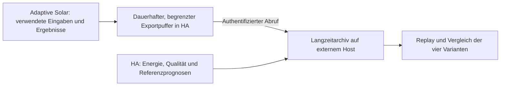

# Physikvergleich und reproduzierbare Prognosearchivierung

Stand: 28.10.2026. Die Physikanalyse bezieht sich auf Adaptive Solar 0.2.14,
Commit 6193efc. **Originaldatenexport, externes Langzeitarchiv und Offline-Replay
sind im Entwicklungsbranch implementiert; die neuen Physikvarianten bleiben
geplant.** Betrieb und Aktivierung auf HA/Archivhost sind noch nicht erfolgt.
[Implementierter Ablauf](../archiv/archivbetrieb.md), [Speichervertrag](../archiv/archive-storage-contract.md).

## Inhalt

- [1. Ergebnis und Priorität](#1-ergebnis-und-priorität)
- [2. Analyse der Physik](#2-analyse-der-physik)
- [3. Vorhandene Daten und Grenzen](#3-vorhandene-daten-und-grenzen)
- [4. Kontrollierter Vergleich](#4-kontrollierter-vergleich)
- [5. Aufgabenverteilung zwischen HA und Archivhost](#5-aufgabenverteilung-zwischen-ha-und-archivhost)
- [6. Datenvertrag und Archivbetrieb](#6-datenvertrag-und-archivbetrieb)
- [7. Arbeitspakete und Abnahme](#7-arbeitspakete-und-abnahme)
- [8. Quellen und Codebelege](#8-quellen-und-codebelege)

## 1. Ergebnis und Priorität

Eine feinere Berechnung innerhalb der Stunde und zusätzliche winkelabhängige
Reflexionsverluste können die physikalische Baseline verbessern. Besonders
interessant sind Randstunden, Schattenübergänge und Zeiträume mit
Leistungsbegrenzung. Ein deutlicher Gewinn bei Stunden- oder Tagesprognosen ist
damit noch nicht gemessen; eine pauschale prozentuale Verbesserung lässt sich
nicht seriös zusagen.

Empfohlen wird zunächst die Archivierung reproduzierbarer Eingaben. Darauf
folgen ein Versuch mit feinerer Zeitintegration und die IAM-Erweiterung
(Incidence Angle Modifier). Vier getrennte Vergleichsarme sollen den jeweiligen
Beitrag und ihr Zusammenwirken zeigen.

Das Archiv dient darüber hinaus späteren Wettermodell-, Ensemble- und
Lernvergleichen. Vorrang haben die nächsten 24/48 Stunden als Grundlage für
Speicherentscheidungen. Die [Wettermodellrecherche vom 28.10.2026](wettermodelle-und-prognosehorizonte.md)
konkretisiert Einzelmodelle, kurze Horizonte, längere Rückfallmodelle und den
zusätzlichen Datenbedarf. Ein kurzer Modellhorizont ist kein Ausschlussgrund.
Echte Wetterensembles sind ab Aufnahmestart vorgesehen: vollständige Mitglieder
von ICON-D2-EPS und IFS-ENS bilden die Grundlage für später geprüfte
Ertragswahrscheinlichkeiten; ein Mittelwert allein genügt dafür nicht.

**Implementierte Architektur:** HA sichert nach ausdrücklichem Einschalten die tatsächlich verwendeten Eingaben mit
einem begrenzten, dauerhaften Exportpuffer. Ein externer Archivhost übernimmt
Langzeitspeicherung und Auswertung. Konkrete Hostnamen, Zielpfade,
Sensorzuordnungen und Messdaten bleiben in der privaten Betriebsdokumentation.
Die Prognoseintegration soll auch ohne externen Archivhost funktionieren.

## 2. Analyse der Physik

### 2.1 Energie innerhalb eines Intervalls

Die aktuelle Intervallprognose berechnet die Stringleistung standardmäßig am
Intervallmittelpunkt. Hay-Davies liefert die Strahlung auf der Modulfläche,
danach folgen Verschattung, Faiman-Temperatur, PVWatts und feste Verluste.
Strings werden je AC-/DC-Stufe summiert und gemeinsam begrenzt.

Der Vorschlag ersetzt die einzelne Auswertung durch mehrere Stützstellen.
Sonnenstand, Schattenfaktor, Temperaturwirkung und gemeinsame Ausgangsbegrenzung
werden jeweils vor der zeitlichen Integration berechnet. Energie ist das
Integral der Ausgangsleistung über die tatsächliche UTC-Dauer; ein Clip nach
der Integration ist bei wechselnder Leistung nicht gleichwertig.

Als Versuch eignen sich etwa Fünfminutenschritte oder geeignete Quadraturpunkte.
An Sonnenauf-/untergängen und Schattenkanten ist die Konvergenz zusätzlich zu
prüfen. Das Verfahren für die zeitliche Verteilung der Wetterkomponenten muss
vorab festgelegt sein und deren ursprüngliche Intervallmittel erhalten.
Einfaches Kopieren der Stundenmittel auf kleinere Zellen liefert noch keine
belastbare zeitliche Verteilung.

Die vorhandene Clear-Sky-Zeitform für Momentanreferenzen ist ein möglicher
Ausgangspunkt, keine fertige Intervallintegration. Feinere Abtastung erzeugt
keine neue Information über Wolken innerhalb der Stunde. Temperatur und Wind
bleiben ohne weitere Eingaben Näherungen der ursprünglichen Quellbedingungen.
Der Unterschied zwischen Momentanwerten und Intervallmitteln ist auch im
[pvlib-Beispiel zur Transposition](https://pvlib-python.readthedocs.io/en/stable/gallery/irradiance-transposition/plot_interval_transposition_error.html)
beschrieben.

### 2.2 Winkelabhängige Reflexionsverluste

Die geometrische Wirkung des Einfallswinkels ist bereits enthalten.
Zusätzliche winkelabhängige Verluste an der Modulabdeckung fehlen im aktuellen
Physikpfad. Dafür bietet pvlib unter anderem das
[physikalische IAM-Modell](https://pvlib-python.readthedocs.io/en/stable/reference/generated/pvlib.iam.physical.html).

Eine Beispielrechnung mit pvlib 0.16.1, Brechungsindex 1,526,
Extinktionskoeffizient 4/m, Glasdicke 0,002 m und ohne Antireflexbeschichtung ergibt:

| Einfallswinkel zur Modulnormalen | Zusätzliche relative Abschwächung der Direktstrahlung gegenüber senkrechtem Einfall |
| --- | --- |
| 60° | etwa 5,4 % |
| 70° | etwa 14,0 % |
| 80° | etwa 36,6 % |

Dies sind Modellwerte, keine gemessenen Anlagenverluste und keine prozentuale
Verbesserung der Gesamtprognose. Glas, Beschichtung und Anteil der Direktstrahlung
beeinflussen die Wirkung. Für diffuse Himmels- und Bodenstrahlung sind passende
eigene Faktoren erforderlich; der Sonnen-Einfallswinkel darf nicht pauschal
auf die gesamte diffuse Strahlung angewandt werden.
[pvlib stellt dafür diffuse IAM-Berechnungen bereit.](https://pvlib-python.readthedocs.io/en/stable/reference/generated/pvlib.iam.marion_diffuse.html)

Feste Verlustparameter und gelernte Schattenfaktoren können bisher fehlende
Reflexionsverluste teilweise mit ausgleichen. Ihre Behandlung muss deshalb
vor dem Vergleich feststehen; zusätzliches IAM und bisherige Lernkorrekturen
dürfen denselben Effekt nicht doppelt abziehen. Optische Wirksamkeit und
thermische Einstrahlung sind im Entwurf ausdrücklich zu unterscheiden.

## 3. Vorhandene Daten und Grenzen

| Datenquelle | Vorhandener Umfang | Eignung für neue Physik |
| --- | --- | --- |
| HA-Lernarchiv | Ausgewählte Baselines, Endprognosen, Features und separate gemessene Energieintervalle | Bewertung gespeicherter Prognosen; keine vollständige Wiederholung mit geänderter Physik |
| Tagesbeginn-Snapshots | Ausgegebene Tagesenergien mit ursprünglicher Provenienz | Historische Tagesprognosen erhalten; keine Rekonstruktion der Wetterkomponenten |
| Wetterclient | Aktueller begrenzter Cache im Speicher | Kein dauerhaftes Originalwetterarchiv |
| Capturewerkzeuge | Ausgewählte Originalprognosen sowie Recorder-Energie und getrennte Qualitätsnachweise | Bausteine für Vergleichsaufnahmen; Originalwetterexport fehlt |
| Separater privater historischer Datensatz | 90 Tage einer AC-Messgruppe, 24.07.–21.10.2026 | Begrenzte historische Diagnose möglich |

Das Lernarchiv enthält keine vollständigen Originalwetterzellen und
Einzelmodellleistungen. GHI, DNI und DHI lassen sich aus einer gemittelten
Leistungsbaseline nicht zuverlässig zurückrechnen. Außerdem werden nur
ausgewählte geeignete Lernziele aufgenommen, nicht sämtliche Prognoseausgaben
einschließlich Nacht, Teilstunden und Fehlerfällen.

Die Grenzen von 120 Tagen, 60.000 Forecastzeilen und 30.000 Istzeilen sind
Obergrenzen des bestehenden Lernarchivs. Sie garantieren keine 120 Tage
vollständiger gemeinsamer Daten. Das Vergleichsarchiv braucht daher einen
eigenen Zweck, Vertrag und Speicherrahmen.

Historische Datensätze mit nachträglich beschafften Wetterläufen und nur
angenommenen Verfügbarkeitszeiten sind kein prospektiver Genauigkeitsnachweis.
Fehlen außerdem technische Belege für Messqualität oder Abregelungsfreiheit,
bleiben ihre Ergebnisse bedingte Diagnosen. Der [Validierungsplan](../entwicklung/validierung.md)
verlangt zeitlich qualifizierte Originaleingaben und Istwerte. Private Rohdaten
und Parameter gehören nicht in dieses Dokument.

Für die Bewertung der Stundenenergie genügen qualifizierte Ist-Energiemengen
auf denselben Stundenintervallen. Minutendaten sind dafür nicht zwingend nötig;
zur Prüfung des Verlaufs innerhalb einer Stunde wären feinere Messdaten hilfreich.

## 4. Kontrollierter Vergleich

| Arm | Zeitliche Berechnung | Reflexionsmodell |
| --- | --- | --- |
| A: Referenz | Bisherige Mittelpunktnäherung | Bisheriger Stand ohne zusätzliches IAM |
| B: Integration | Feinere Integration | Wie A |
| C: IAM | Wie A | Neues, vorab festgelegtes IAM |
| D: Kombination | Wie B | Wie C |

Alle Arme verwenden dieselben ursprünglichen Wettereingaben, Ausgabezeiten,
Zielintervalle, Stringgeometrien, festen Verluste, Ausgangsgrenzen und
qualifizierten Istwerte. Varianten dürfen weder frischeres Wetter noch günstigere
Messfenster erhalten. Fehlende Daten bleiben Lücken.

Im ersten Versuch wird der Einfluss der Physik ohne ML- und Nowcast-Korrekturen
isoliert. Manuelle Geometrie-/Horizontparameter werden eingefroren; der Umgang
mit bereits gelernten Schattenfaktoren wird vorab festgelegt. Ein geeigneter
Ausgangspunkt ist die neutrale gelernte Schattenkorrektur in allen vier Armen.
Das ist ein definierter Physikversuch, keine Wiederholung der produktiven
Gesamtpipeline. Später folgt ein eigener Vergleich mit chronologisch neu
aufgebauten Lernkorrekturen und ausreichender Anlaufhistorie.

Vor Beginn werden Zeitraum, Cutoffs, Ausschlüsse, numerische Einstellungen,
primäre Kennzahl und Mindestgewinn festgelegt. Stundenenergie-MAE und
Tagesenergie-MAE sowie Bias und Abdeckung werden je Ausgangsstufe ausgewiesen.
Randstunden und begrenzte Zeiträume werden zusätzlich getrennt betrachtet.
Nur vollständig qualifizierte Tage zählen zur Tagesenergie; ein Tageslichtfenster
ersetzt keinen vollständigen Kalendertag. Unsicherheit des Vergleichs wird
gemeinsam über Zieltage, nicht über vermeintlich unabhängige Stunden bewertet.

Die bestehende Vorgabe von mindestens 30 vollständigen gepaarten Tagen je
Vergleichsstratum ist eine Untergrenze des
[Validierungsplans](../entwicklung/validierung.md), kein automatischer Beleg für alle Saisons.
Ein historischer Replay und ein anschließender prospektiver Vergleich bleiben
getrennte Nachweise.

## 5. Aufgabenverteilung zwischen HA und Archivhost

| Ort | Aufgabe | Begründung |
| --- | --- | --- |
| HA | Originaleingaben, Ausgaben und angewandte Korrekturen eindeutig verknüpfen | Diese Informationen liegen zum tatsächlichen Berechnungszeitpunkt vor |
| HA | Kurzen, neustartfesten Exportpuffer führen | Unterbrechungen des Archivhosts oder der Verbindung überbrücken |
| Archivhost | Daten abholen, dauerhaft speichern, prüfen und sichern | Langzeitspeicher und Auswertungen unabhängig vom HA-Betrieb |
| Archivhost | Historische Varianten berechnen und Berichte erzeugen | Gleiche eingefrorene Eingaben wiederholt auswerten |

Eine reine HA-Lösung wäre grundsätzlich möglich, würde dort aber auch
Langzeitspeicher, Aufbewahrung und Auswertung bündeln. Die Aufteilung hält
diese zusätzliche Arbeit vom produktiven Prognosebetrieb getrennt.
Ein allein auf dem Archivhost neu gestarteter Wetterabruf bewahrt hingegen
nicht zwingend die von HA tatsächlich verwendete Wetterversion.

## 6. Datenvertrag und Archivbetrieb

### 6.1 Zu archivierende Datensätze

| Datensatz | Erforderlicher Inhalt |
| --- | --- |
| Wetterabruf | Ursprüngliche Antwort ohne Zugangsdaten, Einheiten, Modellkennung, Originalintervalle, Empfangszeit, Parser-/Normalisierungsregeln und daraus erzeugte Wetterzellen |
| Wetterensemble | Vollständige Verläufe je Lauf und Mitglied, erwartete/empfangene Mitglieder, Kontrolllauf soweit vorhanden und Lücken; gemeinsame Variablen- und Zeitzuordnung erhalten |
| Prognoseausgabe | Ausgabezeit, Zielintervalle, verwendete Wetter-IDs, gültige Modellkohorte, Einzelmodellleistungen, Ensemblebaseline und Endergebnis einschließlich Ausfällen |
| Konfiguration | Geometrie, AC-/DC-Messgrenze, Leistungsgrenzen, feste Verluste, Horizonte und Dämpfung; versioniert und über Hash verknüpft |
| Software | Integrations-/Schema-/Featureversion und reproduzierbarer Quell- sowie Bibliotheksstand |
| Beobachtungen und Korrekturen | Original-Berichts- und Empfangszeiten, Werte, Gültigkeit, verwendete GHI-/Leistungs-/Umweltkorrekturen und Schattenzustand zur Ausgabe |
| Istenergie | Originale Recorder-Antworten, angeforderte Einheit, stündliche change-Energie, Erfassungszeit und getrennte Qualitätsbelege |
| Referenzprognosen | Unveränderte ausgewählte Helios-/Open-Meteo-Kurven, tatsächliche Empfangszeiten und gemeinsame Messgrenze |
| Wahrscheinlichkeitsausgabe | Fenster und Energieschwelle, rohe Szenarien/Verteilung, Quantildefinition, Kalibrierungsstand mit Trainingsstichtag und Quellenbindung; getrennt vom Punktforecast |

GHI, DNI und DHI bedeuten globale horizontale, direkte normale beziehungsweise
diffuse horizontale Strahlung. Originalwerte und abgeleitete oder korrigierte
Werte bleiben getrennt. Eine physikalisch ungültige oder nicht gelieferte Zelle
wird weder nachträglich ergänzt noch als Nullwert erfunden.

Alle Datensätze erhalten Schemaversion, eindeutige ID und Inhaltsprüfsumme.
Wiederholte Inhalte können einmal abgelegt werden; verschiedene Empfangs- und
Ausgabeereignisse behalten ihre eigenen Zeiten und Verknüpfungen.
Eine Provider-Laufzeit wird nur eingetragen, wenn sie tatsächlich bekannt ist.
Quell-Empfang, Prognoseausgabe und spätere Archivübernahme sind unterschiedliche
Zeitpunkte. Lokale Tagesgrenzen werden mit Zeitzone auf UTC abgebildet, damit
23-/25-Stunden-Tage korrekt bleiben.

Für eine Wiederholung der vollständigen lernenden Pipeline reichen
Konfigurationshash und letzte Schattentabelle allein nicht aus. Benötigt werden
die am jeweiligen Cutoff verfügbaren Lernzeilen und Korrekturzustände oder eine
vollständig nachvollziehbare chronologische Rekonstruktion.

### 6.2 Übertragung und Ausfallsicherheit

Implementiert ist eine authentifizierte Export-Leseschnittstelle mit
fortlaufendem Cursor und begrenzten Seiten. Der Collector holt alle neuen
Datensätze ab und bestätigt den Cursor erst nach dauerhaftem Speichern.
Nach einem Abbruch darf derselbe Datensatz erneut ankommen; eindeutige IDs
verhindern doppelte fachliche Aufnahmen. Cursor und Archivgeneration bleiben
über Neustarts erhalten; eine Neuinitialisierung erhält eine neue Generation,
damit alte und neue Sequenznummern nicht verwechselt werden.

Der HA-Puffer wird getrennt vom bestehenden Lernstore geführt. Die implementierten
Grenzen und der noch zu erprobende Betriebsrhythmus sind:

| Parameter | Implementierung / Betriebsplan |
| --- | --- |
| Dauer des HA-Puffers | Bis zu 72 Stunden, höchstens 64 MiB Ereignisinhalt und 10.000 Ereignisse; die zuerst erreichte Grenze gilt |
| Abruf durch den Archivhost | Alle fünf Minuten, ohne neue Wetterabrufe auszulösen |
| Langzeitaufbewahrung | 24 Monate; Nutzerentscheidung vom 28.10.2026 |
| Speicherprüfung | Kurzer Pilot; erneute Bewertung nach einigen Monaten, vorgeschlagen nach drei und sechs Monaten ab Aufnahmestart |

Die erneute Bewertung erfasst komprimierte Bytes pro Tag und Modell, Index,
Messdaten, Lernzustände, temporären Replaybedarf und Backups. Daraus wird der
Bedarf für 24 Monate samt Reserve neu hochgerechnet. Mehr Modelle und feinere
Messreihen sind gesondert auszuweisen. Eingefrorene Vergleichsdatensätze bleiben
als vollständige Pakete mit ihren referenzierten Originalen erhalten; ihre
Aufbewahrung wird getrennt von der rollierenden Frist festgelegt.

Bei Überlauf entstehen ein sichtbarer Fehlerzustand und eine dokumentierte
Sequenzlücke; unbegrenztes Anwachsen oder stiller Datenverlust sind zu vermeiden.
Die Prognose bleibt bei Archivfehlern funktionsfähig. Dateischreiben, Kompression
und andere blockierende Arbeit gehören außerhalb des HA-Ereignisloops, gemäß der
[HA-Entwicklerdokumentation](https://contributors.home-assistant.io/core/internals/asyncio/).
Ein erfolgreicher Speicheraufruf allein gilt nicht als Persistenzbeweis:
Wiederanlauf und tatsächliches Lesen der geschriebenen Daten sind zu prüfen.

### 6.3 Ablage und Messqualität

Die Ablage verwendet komprimierte Originaldateien mit einem SQLite-Index für
IDs, Zeiten und Prüfsummen. Originaldateien bleiben maßgeblich; der Index lässt
sich daraus wiederherstellen. Replay bindet Eingaben, Konfiguration, verwendete
Lern-/Schattenzustände und Softwarehashes. Ein Pin bewahrt vorhandene Originale;
fehlende Referenzen bleiben ein Ablehnungsgrund beim Replay.

Istenergie wird nach Stundenabschluss über die vorhandenen Recorder-Collector
gelesen. Abregelung, Quellenausfälle und Resets müssen mit ihrer zeitlichen
Abdeckung nachvollziehbar bleiben; ein einzelner Status zum Abrufzeitpunkt
qualifiziert keine ganze Stunde. Spätere Recorder- oder Qualitätskorrekturen
werden als zusätzliche Revisionen gespeichert, mit expliziter Auswahlpolitik
und eigener Verfügbarkeitszeit.

Referenzprognosen werden rechtzeitig vor vorher festgelegten Cutoffs erfasst.
Späte Antworten bleiben archiviert, sind für eine frühere Entscheidung aber
nicht zulässig. Lücken und Nachtabdeckung werden separat geprüft.
Backups einschließlich Wiederherstellungsprobe gehören zum Archivbetrieb.
Private Konfigurationen und Archivdaten bleiben außerhalb Git und Reviewpaketen;
öffentliche Beispiele verwenden ausschließlich fiktive Zuordnungen.

## 7. Arbeitspakete und Abnahme

Die Pakete konkretisieren
[AS-OPT-03](adaptive-solar-bewertung.md#as-opt-03-einzelmodelle-und-vergleichseingaben-archivieren).
Die technischen Grundlagen aus 1–4 sowie Baseline- und Ensemble-Replay aus 5/7
sind implementiert. Pilotbetrieb, Speicherbedarf über mehrere Monate, lokale
Prognosegüte und unabhängige Kalibrierungsprüfung stehen aus. Paket 6 ist geplant.
Der konkrete Implementierungs- und Prüfstand steht in [Archivbetrieb](../archiv/archivbetrieb.md).

| Paket | Abhängigkeit und Ergebnis | Wesentliche Abnahme |
| --- | --- | --- |
| 1. Daten- und Vergleichsvertrag | Zuerst: Schema, Zeitsemantik, Kohorte, Messgrenzen, Wettermodellumfang und Ressourcenmessplan | Ein vollständiges Beispiel ist ohne private Betriebsdaten erklärbar; Cutoffs und Ausschlüsse stehen vor dem Versuch fest; kurze und lange Modellhorizonte bleiben nutzbar |
| 2. HA-Erfassung und Exportpuffer | Nach 1: Originalwetter und tatsächlich verwendete Prognoseeingaben erfassen | Neustart, unterbrochener Schreibvorgang, fehlerhafte Daten und Pufferüberlauf sind geprüft; bestehende Lernhistorie bleibt erhalten |
| 3. Collector und Langzeitarchiv | Nach 1; Transportabnahme nach 2 | Wiederholter Abruf erzeugt keine Doppelzählung; Cursor geht erst nach dauerhaftem Speichern vor; Lücken, Prüfsummen und Indexwiederaufbau sind geprüft |
| 4. Istwerte und Referenzen | Nach 1; vorhandene Capturewerkzeuge erweitern | Ganze Intervalle, Rohrevisionen, Qualitätsnachweise, Fristen und beide DST-Wechsel sind nachvollziehbar |
| 5. Baseline-Replay und Pilot | Nach 2–4 | Festgelegte gespeicherte Physikbaseline ist innerhalb vorab definierter numerischer Toleranz reproduzierbar; Datenrate, Speicherbedarf und vollständige gemeinsame Tage sind gemessen |
| 6. Vierarmvergleich | Nach 5; begrenzte private historische Vorstudie separat möglich | Varianten B/C/D gegen A auf derselben Paarmenge; Stunden-/Tagesfehler, Bias, Abdeckung und Unsicherheit je Stufe dokumentiert |
| 7. Ensemble-Replay und Wahrscheinlichkeitsprüfung | Erfassung ab 2–4; nach 5 unabhängig von 6 auswertbar | Vollständige Mitgliedsverläufe reproduzierbar; Energiequantile und Schwellenwahrscheinlichkeiten chronologisch kalibriert und auf späteren Tagen geprüft; Quellenwechsel erzeugen keine erfundenen Szenarien |

Die technische Archivabnahme, ein historischer Versuch, die prospektive
Genauigkeitsprüfung und eine mögliche produktive Modelländerung bleiben
getrennte Schritte. Ein funktionierender Export oder ein bestandener Test
belegt noch keinen Prognosevorteil.

## 8. Quellen und Codebelege

Quellen und Repositorystand wurden am 28.10.2026 geprüft. Die IAM-Prozentwerte
sind eine Beispielrechnung mit den in Abschnitt 2.2 genannten Parametern.
Erwarteter Nutzen und Betriebsparameter sind ausdrücklich Vorschläge.

- [Physik und Momentanreferenzen](../../custom_components/adaptive_solar/core/physics.py)
- [Forecastengine und Korrekturen](../../custom_components/adaptive_solar/core/engine.py)
- [Lernarchiv und Persistenz](../../custom_components/adaptive_solar/coordinator.py)
- [Wetterclient und Parser](../../custom_components/adaptive_solar/weather.py)
- [Aufnahmeleitfaden](../entwicklung/benchmark-aufnahme.md) und [Implementierungsvertrag](../technik/implementation-contract.md)
- [Forecast-Capture](../../scripts/capture_ha.py), [Istwert-Capture](../../scripts/capture_actuals.py) und [Auswertung](../../scripts/evaluate.py)
- [Validierungsplan](../entwicklung/validierung.md), [bestehende Bewertung](adaptive-solar-bewertung.md) und [Datenschutz im aktuellen Stand](../anwendung/datenschutz.md)
- [pvlib: Intervallmittel und Transposition](https://pvlib-python.readthedocs.io/en/stable/gallery/irradiance-transposition/plot_interval_transposition_error.html)
- [pvlib: physikalisches IAM](https://pvlib-python.readthedocs.io/en/stable/reference/generated/pvlib.iam.physical.html)
- [pvlib: diffuses IAM](https://pvlib-python.readthedocs.io/en/stable/reference/generated/pvlib.iam.marion_diffuse.html)
- [Home Assistant: asynchrone Verarbeitung](https://contributors.home-assistant.io/core/internals/asyncio/)
